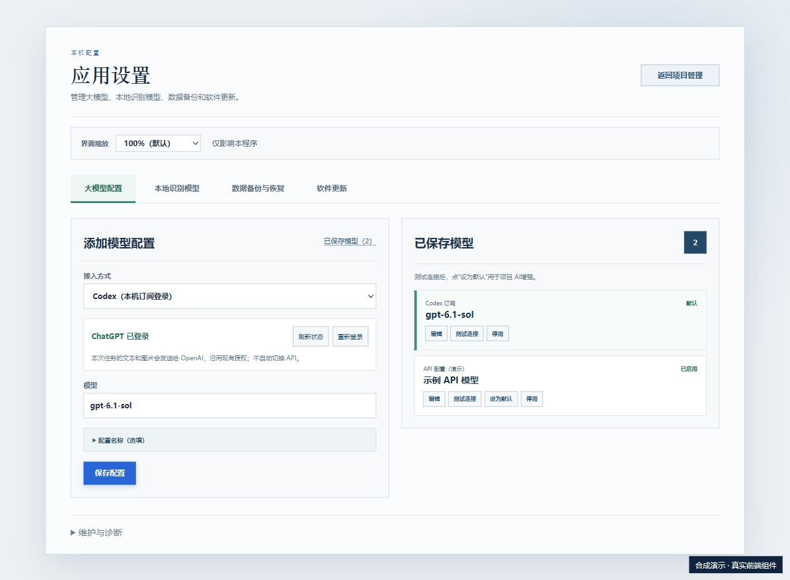
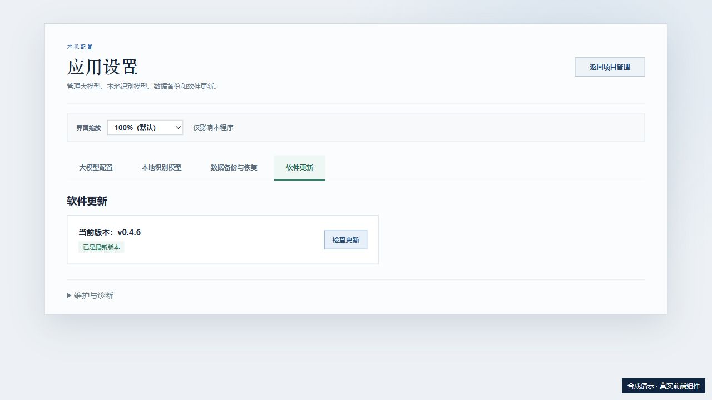
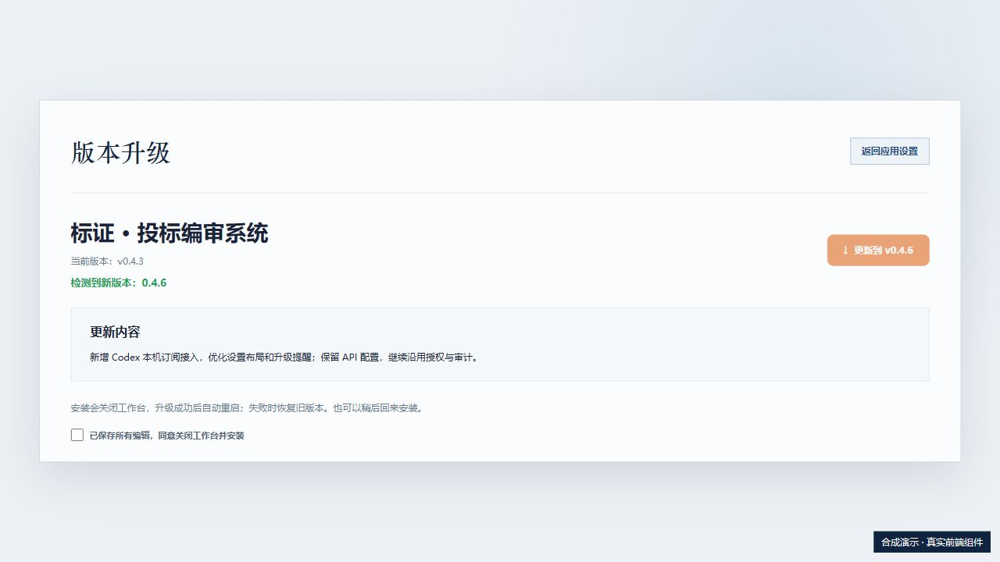

# 使用帮助

[返回产品主页](README.md) · [下载程序](https://github.com/yaoyouzhong/Bidding-releases/releases/latest)

## GitHub 和 Gitee 分别提供什么？

[Gitee 国内分卷下载](https://gitee.com/yaoyouzhong/Bidding-releases/releases/tag/v0.4.7)：下载全部分卷和配套脚本到同一文件夹，双击 install.cmd，校验合并后安装。GitHub 提供完整 EXE。分卷不能直接用于应用内更新；无法访问 GitHub 时请手动安装。

本次发布 0.4.7：完善人员目录、多文件导入与逐项核对，修复资料分类和姓名关联，改善批量选择与简历生成反馈。简历附件支持清晰压缩或保留原图。安装包约 116.3 MiB，不内嵌识别模型；已有匹配缓存继续复用，新电脑可下载或离线导入模型。Gitee 提供四卷手动安装，应用内更新仍需下载 GitHub 完整 EXE。

## 安装前需要准备什么？

使用 Windows 10 / 11 64 位电脑，首次安装请保持联网。企业信用和学信网查询需要 Google Chrome；需要扫码或人工验证时，按官网提示完成。

## 图片和扫描文件识别需要另行安装吗？

0.4.7 安装包不内嵌模型；已有匹配缓存继续复用，新电脑首次识别前需下载或离线导入。请在应用设置中点击“下载模型”，或从独立模型发布页下载文档、验证码 ZIP 模型包后点击“导入模型”，无需解压。已有匹配模型显示就绪时无需重复导入。离线导入后即可进行本地识别；详见[模型说明](TECHNICAL_NOTES.md#ocr-模型)。

## 不配置 AI，也能使用吗？

可以。文档解析、扫描件文字识别在本机完成，识别模型可单独下载或离线导入。批量导入与资料管理、按已确认模板生成简历、证件日期提醒和已有规则检查，都可使用本地能力，不要求先配置 AI 服务。识别不完整时，可以对照原件补充或修正。

AI 是按需开启的增强能力，用于进一步理解复杂材料、辅助提取要求、起草响应和分析语义关联。不开启 AI 时，这些增强功能不可用，本地功能仍可继续使用。

文档解析、文字识别等基础处理在本机完成，无需接入在线 AI。企业信用查询、学信网学历核验，以及程序版本检查和下载安装更新需要联网。

## API 与 Codex，两种接入可手动选择

0.4.6 在“应用设置 → 大模型配置”增加 **Codex（本机订阅登录）**。已安装官方 Codex CLI 并使用 ChatGPT 登录时，可选择模型、保存配置；不需要填写 API Key。保存后显示在“已保存模型”列表，测试连接，再点击“设为默认”。原 API 配置继续保留；需要切换时由用户选择。

本机登录仍会把本次任务所需文本和图片发送给 OpenAI。项目和独立用途继续按现有授权执行；额度、登录或超时失败会明确提示，**不会自动切换收费 API**。模型结果先作为候选，由用户对照原件确认。

发现新版本时，设置入口提供绿点及版本按钮。查看说明，先保存编辑、结束任务，再勾选安装确认；下载后校验更新签名。安装器尚无 Windows Authenticode 签名，下载校验不能替代发布者签名。

## AI 功能怎样开启？

先在应用设置中配置并启用模型，再为需要的用途开启 AI 增强。开启后相关内容会发送给所配置的模型；生成的候选和建议应结合原件核对。未开启时，已有本地资料管理和规则检查仍可使用。

## 怎样升级？

应用提示有新版本后，保存工作、等待当前任务结束，点击“更新到 v…”，查看更新说明并勾选已保存编辑确认后安装。安装完成后程序重启。如提示需要使用完整安装包，请按[版本说明](RELEASE_NOTES.md)操作。

## Windows 提示无法验证发布者怎么办？

当前安装包尚无 Windows 发布者签名。请确认文件来自本项目的 GitHub 发布页；如需核对下载文件，见[安装环境与下载校验](TECHNICAL_NOTES.md#安装与下载渠道)。无法确认来源时不要运行。

## 出现问题怎样反馈？

记录程序版本、操作步骤和错误提示，可附脱敏截图。不要上传真实投标材料、身份证件、项目数据库、密码或密钥。

[反馈问题](https://github.com/yaoyouzhong/Bidding-releases/issues) · [技术与维护说明](TECHNICAL_NOTES.md)

## 从旧版本升级

0.4.1 及以前版本需要手动下载安装 0.4.7 一次，旧 ZIP 更新通道保留原兼容版本。保存工作、结束处理任务并退出旧程序后，运行本版 EXE。

<!-- distribution-assets-compact -->
程序下载页只保留安装文件、更新所需文件、校验和及完整第三方资料归档。手册、界面截图和总览视频继续在[产品主页](https://yaoyouzhong.github.io/Bidding-releases/)查看；模型修复包集中在[独立模型下载页](https://gitee.com/yaoyouzhong/Bidding-releases/releases/tag/models-v1)（[GitHub 备用](https://github.com/yaoyouzhong/Bidding-releases/releases/tag/models-v1)）。0.4.7 默认安装与升级包不内嵌模型，已有匹配缓存继续复用；新电脑需先准备模型。

## 旧简历 Word 不能编辑怎么办？

0.4.7 已修复导出继承模板只读保护的问题。升级后重新生成，文字可编辑、原生表格可插入行列；升级不会自动修改旧文件，请重新导出或使用已单独保存的可编辑副本，原件继续保留。

重新导出时会带入已保存的项目岗位，并保留已明确设置的项目经理等角色；人员清单与简历中的岗位保持一致。旧文件需要重新导出，原件与已保存选择继续保留。
